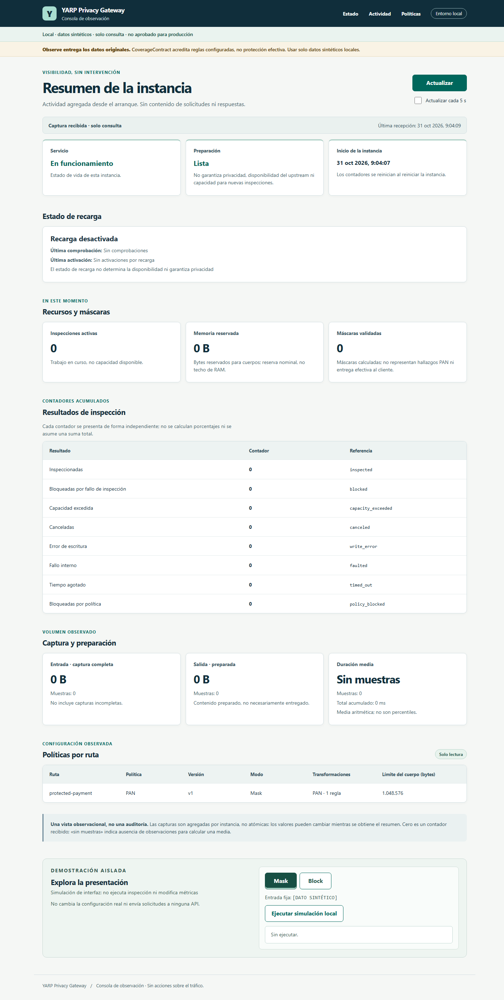

# MVP-48 — Dashboard local: presentación y navegación

El panel sigue siendo **local, sintético y de solo consulta**, no una consola
administrativa ni una certificación de privacidad. No cambia rutas, políticas,
contratos de API, configuración, paquetes o controles de acceso.

## Presentación

- Cabecera más compacta, marca sin el identificador histórico «MVP24» y navegación
  por anclas a estado, actividad y políticas.
- Jerarquía de títulos, tarjetas y estados más clara, tablas con desplazamiento
  horizontal confinado y distribución adaptada a pantallas pequeñas.
- Avisos visibles: Observe entrega originales; readiness no garantiza privacidad;
  máscaras calculadas no son hallazgos ni entrega confirmada; reserva nominal no
  equivale a un techo de RAM. La simulación se mantiene separada del tráfico real.
- Foco visible en cabecera y controles, objetivos táctiles de al menos 44 px en
  los controles medidos y enlace para saltar al contenido.

### Capturas reales de la instancia local, sin tráfico

No son datos de producción ni resultados simulados de protección. Los contadores
en cero corresponden al resumen real recibido de una instancia nueva.

[Captura completa de escritorio](images/mvp48-dashboard-desktop.png) ·
[Captura completa de móvil](images/mvp48-dashboard-mobile.png)



## Corrección de teclado

La prueba en Edge detectó que deshabilitar nativamente el botón **Actualizar**
durante la petición trasladaba el foco al body. Se sustituyó ese estado por
`aria-disabled`, conservando la guarda `inFlight` que evita peticiones duplicadas.
El control permanece en el orden de teclado; no se fuerza el foco mediante script.
Si el usuario avanza con Tab mientras carga, completar la respuesta no le roba
el foco. El estado ocupado utiliza colores opacos para conservar el contraste del
contorno, en vez de reducir la opacidad del elemento completo.

## Validación observada

- Build Release `--no-restore --no-incremental`: **0 advertencias / 0 errores**.
- Suite completa: **1663/1663 PASS**, cero omitidas (1m39s).
- Cuatro pruebas nuevas en
  [DashboardPresentationTests](../Gateway.Tests/DashboardPresentationTests.cs):
  IDs de controles, avisos de alcance, navegación/landmarks y script externo bajo
  la misma CSP. No sustituyen la validación de navegador.
- Edge headless real mediante CDP, sin instalar Playwright/Puppeteer ni paquetes:
  **38 comprobaciones PASS** sobre los assets finales. Incluyen ausencia de
  desbordamiento del documento a 320/375/720/768/1440 px, teclado, foco, estado
  ocupado sin peticiones duplicadas, tablas con identificadores largos, carga,
  error 503, conservación de captura/fecha y reintento, recarga y autopoll.
- Cinco comprobaciones adicionales: texto exacto de última política válida,
  readiness independiente del rechazo de recarga, pausa al ocultar realmente la
  pestaña y reanudación del polling al volver. Su evidencia se reutiliza del mismo
  HTML/JS; el cambio CSS posterior solo afectó colores del botón ocupado.
- Contraste calculado del botón ocupado: contorno **6.27:1**, texto **7.15:1**;
  opacidad 1 y color estable durante hover. También se comprobaron contrastes
  de texto/cabecera, no una auditoría exhaustiva de todos los elementos.
- Las simulaciones Mask/Block no emitieron solicitudes adicionales. La red
  observada del panel usó únicamente GET del mismo origen. Cero excepciones JS o
  errores inesperados; dos logs 503 previstos pertenecen a escenarios sintéticos.
- El coordinador inspeccionó capturas completas reales de escritorio y capturas
  sintéticas de móvil/errores. No observó solapamiento de secciones; las tablas
  móviles conservan scroll horizontal dentro de su región, no de toda la página.
- Gateway y Edge de cada ejecución se cerraron normalmente; la comprobación final
  de procesos no encontró hosts/navegadores de esta tarea todavía activos.

Los escenarios de error, carga retenida y valores no cero interceptaron **solo**
el GET del resumen mediante CDP. Son pruebas de interfaz claramente sintéticas,
no fallos del backend real ni evidencia de inspección de tráfico.

### Límites explícitos

**Zoom nativo al 200 %: no verificado.** Ni la preferencia de un perfil nuevo ni
las teclas enviadas mediante CDP cambiaron la calibración de DPR/ancho. No se
presenta el reflow a 720 px como sustituto de zoom real. Tampoco se certifica
WCAG completa, lectores de pantalla, otros navegadores o dispositivos táctiles
físicos. Esas comprobaciones quedan pendientes de una revisión de accesibilidad
ampliada; no impiden describir las mejoras y pruebas concretas observadas.

La primera prueba de navegador detectó el foco perdido (17 PASS/1 FAIL); una
ejecución previa del harness no había confirmado el GET y se descartó como prueba
de conservación de foco. El fix pasó después las verificaciones de petición y
teclado. Un segundo ajuste conservó el contraste del foco en estado ocupado.

## Reproducción y trazabilidad

Desde un clon preparado, con el SDK fijado, revisar proyectos antes de ejecutar:

```powershell
dotnet build ProyectoSeguridad.slnx -c Release --no-restore --no-incremental
dotnet test ProyectoSeguridad.slnx -c Release --no-build --no-restore
dotnet run --project Gateway -- --urls http://127.0.0.1:5100
```

Abrir `http://127.0.0.1:5100/dashboard/`. Probar Tab, Actualizar, avance de foco
durante carga, regiones de tablas y simulación local. Los escenarios sintéticos
automatizados requieren un harness que intercepte exclusivamente el resumen,
sin enviar tráfico al proxy ni modificar políticas.

TARGET de pruebas: BASE `faf38608eba3d8473fe3dd2f75c5ceab2bf36545` más cambios en
los tres assets y `DashboardPresentationTests.cs`, construidos antes del commit.
Las pruebas de navegador y la suite final usaron DLL Gateway con idéntico hash.
Las fuentes quedaron consolidadas en `e324a6be114d2020984ffcef8ab9e86e362e6b2d`;
no se reconstruyeron binarios por crear ese commit.
Los cambios de documentación/capturas posteriores no requieren repetir binarios.
La campaña de rendimiento MVP-47 sigue siendo histórica, identificada por sus
fuentes/binarios; no se atribuye al nuevo binario con recursos embebidos distintos.

Artefactos locales bajo `Temp/opencode/MVP48-dashboard/`: `browser-20261031-d/`
(38 checks, harness y capturas), `browser-20261031-c/` (cinco checks y limitación
de zoom), `browser-20261031-a/` (RED de foco), `full-final/` (TRX).
Los perfiles temporales, logs y capturas sintéticas no se publican.

| Artefacto | SHA-256 |
| --- | --- |
| index.html | `D2CD1897A920907B797849797A66EE79BD404F34B6D490F60C3A31C04C92A252` |
| styles.css | `1FA6B41CDB4FC87CEA6B14D062F1A803E8A719127A6558E7F664834A6454A386` |
| app.js | `82DC46418682C93594482720E043F1A5D70E7D3867F30AFF8AAA7BB85A8DEB73` |
| DashboardPresentationTests.cs | `58F6C30B622FFA18B5B34B167D866DC77BD23993B8B0AB1A2378483E6CC39DAE` |
| Gateway.dll | `94F7C36DB3ED12438A2163983A80A0401CBBFA47D8A686F4389D1D9C20C3029B` |
| mvp48-full-final.trx | `0A1409668EA08D7433835F12FE90027A2109429633666A4E45B05586D72FBA2F` |
| browser-20261031-d/results.json | `C4E0347E0EA10AC8B787889B2AC58E8F0AF54F18E7E3DBE6095E1CC36F859F72` |
| browser-20261031-c/results.json | `955E9014B7AFC041FE2043B16AB9A378B0822C3DFEE9B6EA1E2053C1BABF67EB` |

Este pulido no cierra RF-11/CA-09, presupuestos de rendimiento ni preparación de
producción. No cambia los estados de la [matriz SRS](MVP43-acceptance-matrix.md).
